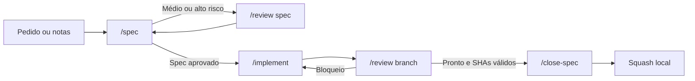
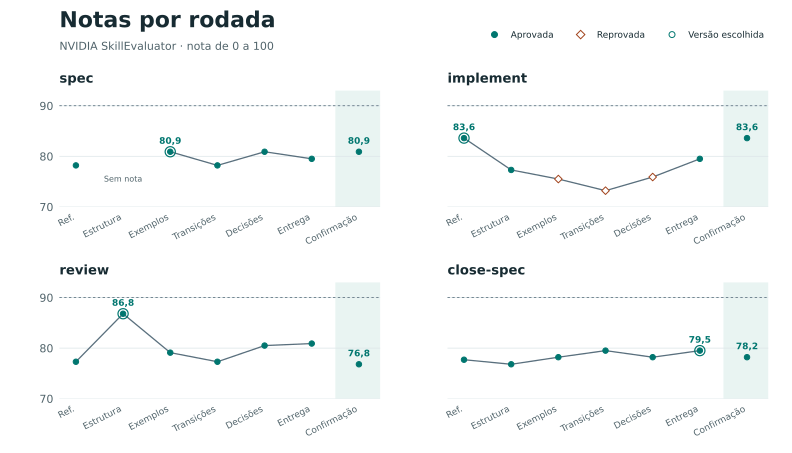
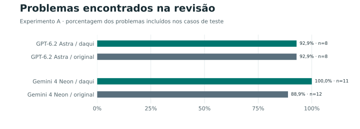
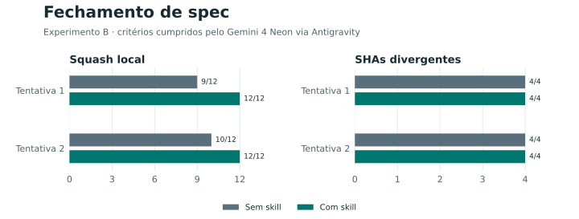

# skills

Aqui ficam as skills que uso no trabalho com o Devin CLI. As que estão aqui hoje são para mudanças em pipelines de dados. Uso `/spec` para escrever o plano e `/implement` para tocar a mudança numa worktree. A revisão roda com um modelo de outro fornecedor e registra os commits que conferiu.

[Instalação](#instalação) · [Fluxo](#fluxo) · [Benchmarks](#benchmarks) · [Método e decisões](docs/decisoes.md)

## Fluxo



| Comando | Entrega |
| --- | --- |
| [`/spec`](skills/spec/SKILL.md) | Spec em `specs/` com risco, critérios verificáveis e passos. |
| [`/implement`](skills/implement/SKILL.md) | Mudança em worktree, commits com `Validado:`, resultados de aceite e referências julgadas. |
| [`/review`](skills/review/SKILL.md) | Parecer sobre o spec ou veredito sobre o diff, com evidências e SHAs. |
| [`/close-spec`](skills/close-spec/SKILL.md) | Squash local do commit revisado, spec arquivado e pendências registradas. O push fica a cargo do usuário. |

Uso o `explorer` quando preciso levantar algo no código ou nos dados antes de decidir. O `reviewer` só lê. O perfil dele aponta para GPT-6.2 Astra, da OpenAI. [Explorer](agents/explorer.md) · [Reviewer](agents/reviewer.md)

## Instalação

No repositório do pipeline, copie as pastas para `.devin/`. Os exemplos usam um checkout chamado `skills` na pasta ao lado.

**Bash**

```bash
mkdir -p .devin/skills .devin/agents
cp -r ../skills/skills/. .devin/skills/
cp ../skills/agents/*.md .devin/agents/
```

**PowerShell**

```powershell
New-Item -ItemType Directory -Force .devin/skills, .devin/agents | Out-Null
Copy-Item ../skills/skills/* .devin/skills/ -Recurse
Copy-Item ../skills/agents/*.md .devin/agents/
```

Para instalar globalmente, use `~/.config/devin/` ou `%APPDATA%\devin\` no Windows. Confira o identificador do modelo com `devin models list --format json`. Se alterar o modelo, atualize o campo `model:` e o nome no corpo do perfil instalado. [Skills no Devin CLI](https://docs.devin.ai/cli/extensibility/skills/creating-skills) · [Perfil do revisor](agents/reviewer.md)

## Benchmarks

### Modelos que aparecem nos testes

| Modelo | Onde entrou |
| --- | --- |
| GPT-6.2 Astra, da OpenAI | Revisor configurado para o Devin. Nos testes de revisão, rodou pelo Codex CLI com esforço `max`. |
| Gemini 4 Neon, do Google | Testou a revisão e o fluxo pelo Antigravity. No teste de revisão, rodou com esforço `xhigh`. |
| Claude Opus 5.5, da Anthropic | Rodou parte dos testes de revisão e de fluxo pelo Claude Code. No teste de revisão, rodou com esforço `max`. |
| Nemotron 3.5 Lightning, da NVIDIA | Leu e pontuou os arquivos `SKILL.md` via NVIDIA Build. |

[Método e dados dos experimentos](docs/experimentos.md) · [Configuração dos revisores](bench/expA/run_expA.py)

### Notas das skills

Pedi ao NVIDIA SkillEvaluator 1.0.1 para pontuar as instruções das quatro skills. A rubrica tem nove critérios. Para passar, a skill precisa de 70/100 no total e 7/10 em cada critério. Mantive a versão que teve a maior nota entre as aprovadas. [Método](docs/experimentos.md#skillevaluator) · [Documentação da NVIDIA](https://docs.nvidia.com/skills/skillevaluator/tier1-validation)



A linha tracejada marca a meta de 90. Na coluna sombreada, o juiz reavaliou as versões escolhidas. A mesma versão de `review` tirou 86,8 na seleção e 76,8 na confirmação. [Notas por rodada](docs/data/rubrica-nvidia.csv) · [Resultados da confirmação](docs/experimentos.md#busca-por-90100)

### Revisão de mudanças

No experimento A, usei seis casos com dados sintéticos, incluindo mudanças corretas e mudanças com problemas conhecidos. O GPT-6.2 Astra encontrou 92,9% dos problemas com cada versão. O Gemini 4 Neon encontrou 100% com a skill daqui e 88,9% com a original. As versões usam idiomas diferentes e o número de execuções varia por grupo. [Resultados do experimento A](docs/data/expA_summary.csv) · [Gabarito](bench/expA/cases.json)



### Fechamento de spec

No teste de squash local, o Gemini 4 Neon cumpriu os 12 critérios nas duas tentativas com `close-spec`. Sem a skill, ficou em 9/12 e 10/12. Os pontos que faltaram tinham a ver com o registro de teste, risco ou reversão. Quando os SHAs divergiam, o Gemini cumpriu os quatro critérios com e sem a skill. [Resultados do experimento B](docs/experimentos.md#fechamento-de-spec)



### Limites dos testes

Os experimentos A e B usaram dados sintéticos e CLIs substitutos. Ainda falta rodar esses casos com as versões atuais no Devin CLI. Nas checagens estáticas, o Tier 1 passou 9/9 sem juiz após a instalação do Gitleaks. Uma repetição ficou em 8/9 porque o SkillSpector não conseguiu obter o lock.

[Guia do benchmark](bench/README.md) · [Relatório de experimentos](docs/experimentos.md) · [Dados versionados](docs/data/)

## Créditos

Adaptei o fluxo que o Felipe Aguirre apresentou no encontro da comunidade Claude no Nubank. A skill de revisão dele também está em `bench/upstream/`, para repetir a comparação. [felipeam86/pipe-skills](https://github.com/felipeam86/pipe-skills) · [Licença MIT original](bench/upstream/LICENSE)

O método de avaliação se apoia na skill de criação da Anthropic e no avaliador da NVIDIA. [Anthropic skill-creator](https://github.com/anthropics/skills/tree/main/skills/skill-creator) · [NVIDIA SkillEvaluator](https://github.com/NVIDIA/SkillEvaluator)
